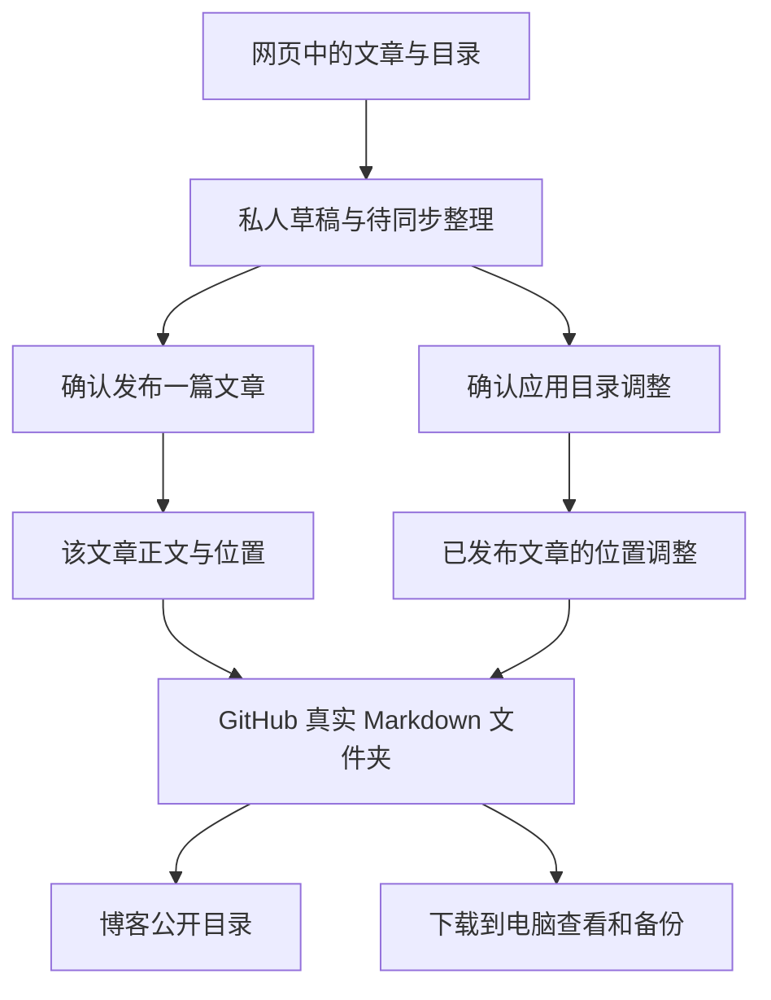
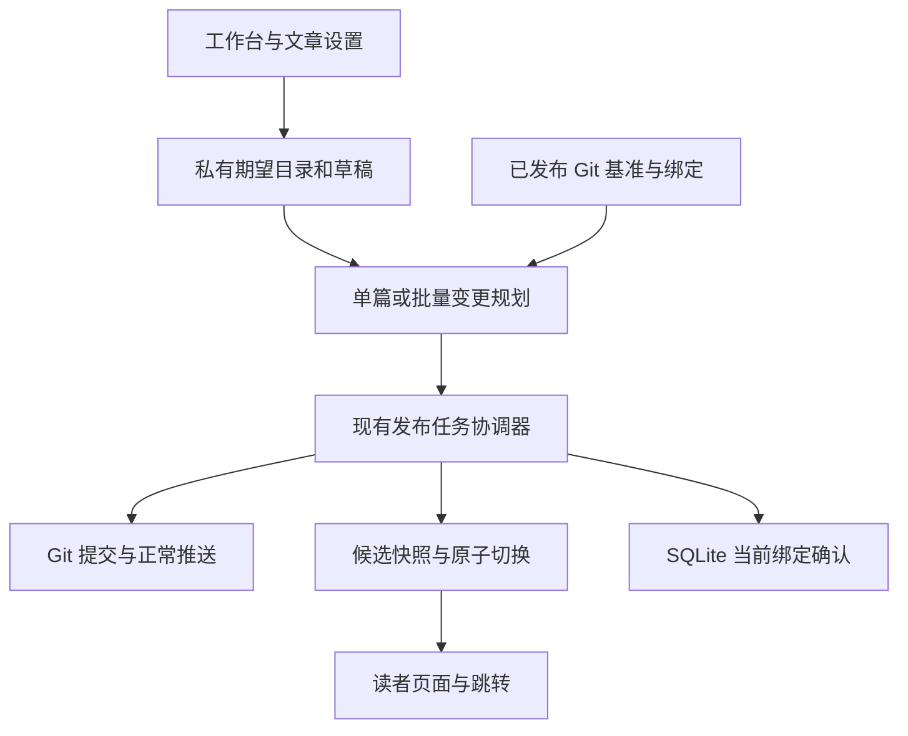
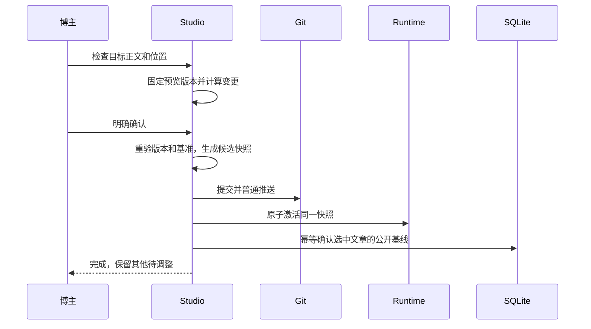
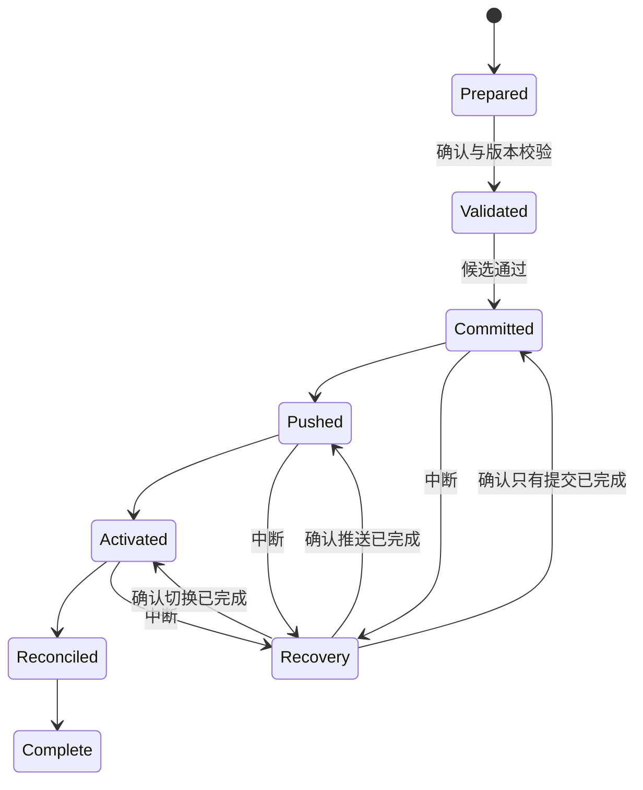
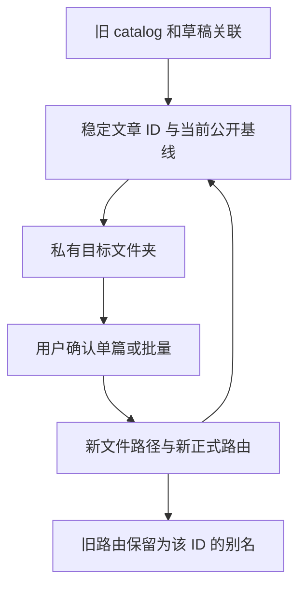
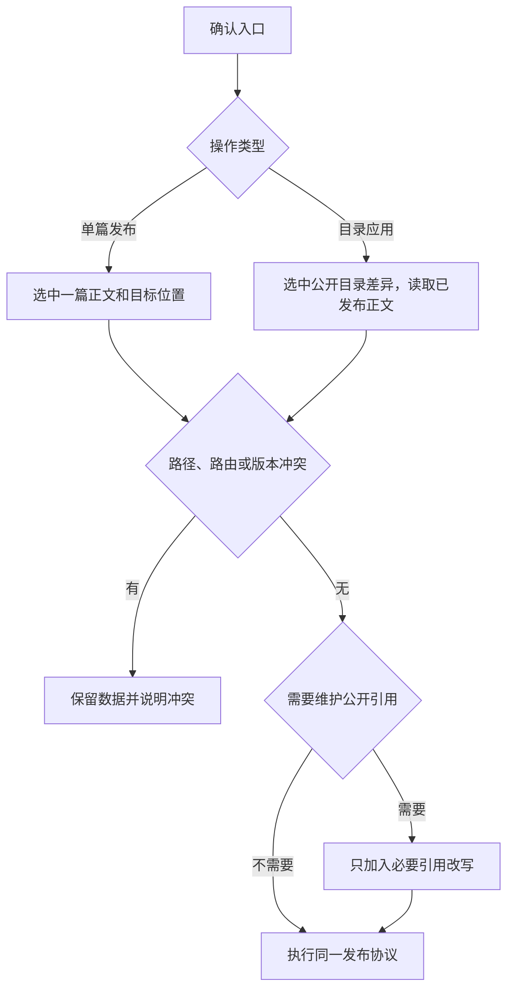
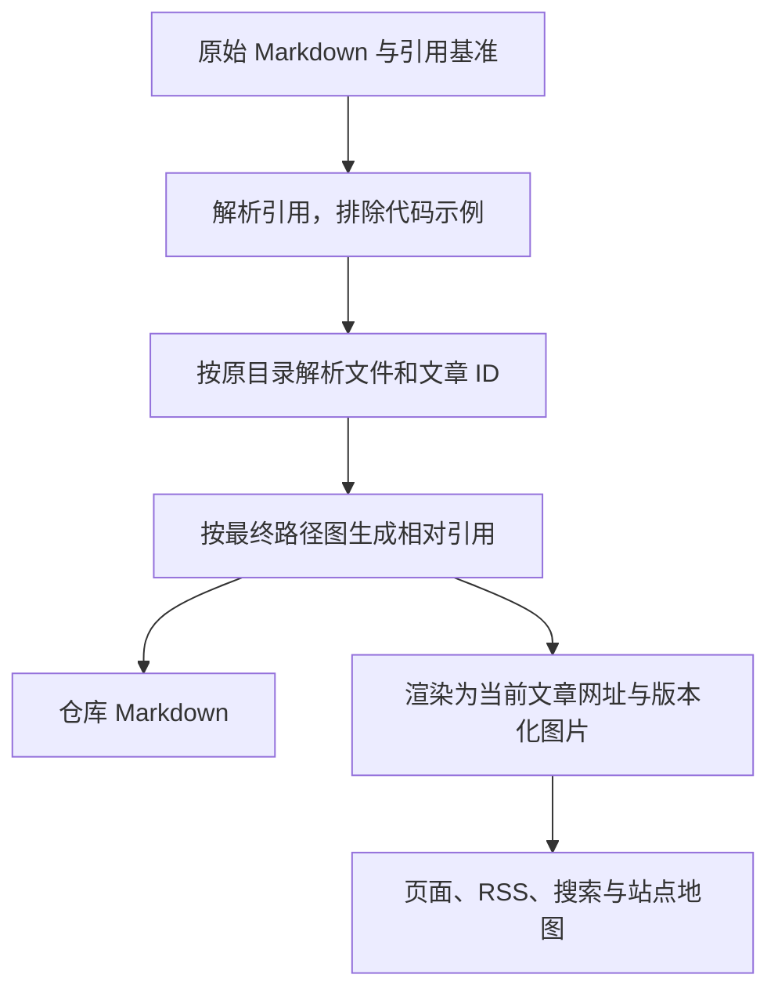
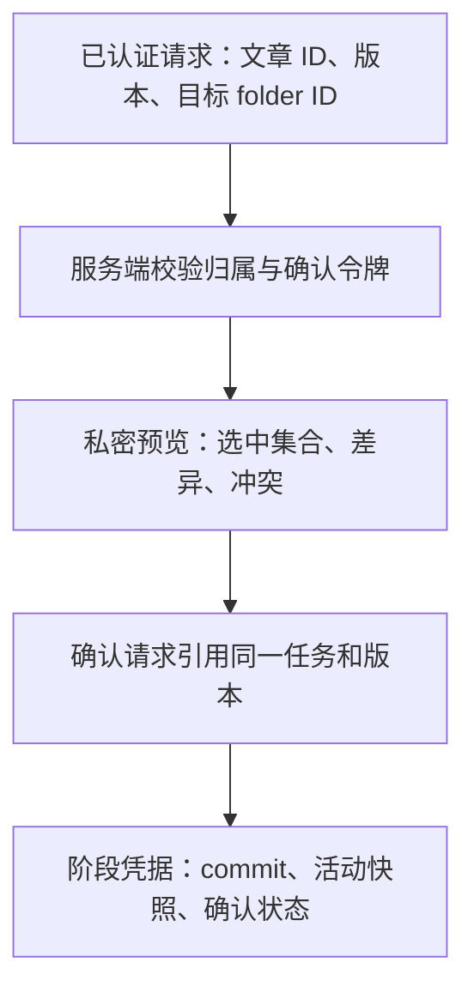

# Studio Directory Alignment - Plan

## Goal Capsule

- **Objective:** 博主在网页整理一次文章目录，发布后能在博客、GitHub 和下载的仓库中找到一致的文章归属。
- **Means:** 工作台目录对应真实文章文件夹，以明确确认的操作同步公开内容。
- **Product authority:** 用户确认的本文件 Product Contract；当前本地实现是改造起点，不是与本合同冲突时的行为依据。
- **Execution profile:** 本地分阶段实现与隔离验收；本计划不授权推送、部署或操作正式文章。
- **Stop conditions:** 遇到无法唯一关联的旧文章、冲突路径或未知发布阶段时停止该公开操作，保留私有内容。
- **Ownership:** 实现者完成本地验收，用户查看效果后另行决定推送及服务器部署。

---

## Product Contract

### Summary

统一工作台目录、文章分类和已发布 Markdown 的真实文件夹归属。
网页作为写作和整理入口，单篇发布携带该文章正文和当前位置，批量目录整理另行确认。
移动后的正式网址跟随目录改变，旧链接跳转到新位置；目录和文件名支持中文。
GitHub 与下载的仓库用于查看和备份。

### Problem Frame

目前用户需要分别理解工作台位置、文章分类、公开归档和仓库文件路径。
在工作台移动文章后，GitHub 文件仍在原位置，读者目录又需要单独操作，导致“整理好了”没有明确含义。
用户希望像管理普通 Markdown 文件夹一样整理文章，并在下载的仓库里找到同样的位置。

### Key Decisions

- **真实文件夹对齐。** Governs R1, R5, R7. (session-settled: user-directed — chosen over metadata-only directory mapping: 用户希望下载仓库后在同样的文件夹找到文章。)
- **整理后统一应用。** Governs R6, R7, R8. (session-settled: user-directed — chosen over syncing every move immediately: 连续整理后一次同步，避免每次移动立即影响线上。)
- **网页单向管理。** Governs R2. (session-settled: user-directed — chosen over bidirectional local editing: 用户只需要在电脑查看和备份，优先保持简单。)
- **位置与分类统一。** Governs R3, R4. (session-settled: user-approved — chosen over separately selecting category and location: 减少重复操作，防止归属不一致。)
- **单篇发布携带自身位置，批量整理不带草稿正文。** Governs R5, R7, R9. (session-settled: user-approved — chosen over preserving the old folder during an individual content publication: 已移动的文章确认发布时，正文和新目录一起生效，其他文章不受影响。)
- **网址跟随目录改变。** Governs R11. (session-settled: user-directed — chosen over keeping the original canonical URL after a move: 文章网址应体现新的目录归属。)
- **支持中文命名。** Governs R16. (session-settled: user-directed — chosen over ASCII-only paths: 用户已有中文文件名和中文标题。)

### Requirements

**Directory model and interaction**

- R1. 同步成功后，工作台中已发布文章的层级、博客读者目录和 GitHub 文章内容根目录下的真实文件夹层级一致。
- R2. 本轮仅支持从网页管理内容，下载仓库用于查看和备份，不提供本地修改回传到工作台的双向同步。
- R3. 文章设置使用“所在目录”替代独立的“分类”，文件树、移动面板和设置中的位置选择必须反映同一归属。
- R4. 标签保持独立，不因文章目录调整而改变。
- R5. 单篇确认发布，无论首次发布还是更新，均将该文章已确认的正文及当前目录归属写入仓库并公开，不连带应用其他文章的待同步调整；没有移动时使用原目录。

**Organizing and applying changes**

- R6. 新建、重命名或移动目录以及移动文章后，工作台立即保存并展示目标结构；涉及已发布内容的未应用变化必须可辨认且可撤销。
- R7. 用户确认“应用目录调整”后，批量同步已发布文章的真实文件位置和博客归属；目录操作不得夹带未发布的正文修改。
- R8. 只有仓库和博客均完成对应更新才显示同步成功；失败时保留可恢复的待同步状态，不能静默覆盖冲突文件或丢失文章。
- R9. 纯目录调整和文章内容发布各有明确的确认边界，保存草稿不触发其中任一公开操作。

**Privacy and compatibility**

- R10. 未发布草稿及仅含草稿的目录保持服务器私密；GitHub 下载仅备份已公开内容，私人草稿继续使用服务器备份。
- R11. 移动已发布文章或重命名其目录并完成公开同步后，正式网址随新路径改变；旧网址跳转到当前网址，正文图片及已有文章间链接继续可用。
- R12. 保留已选定的左右工作台、拖拽移动和按需出现的底部“移动到”面板；目录选择层级随结构动态生成。
- R13. 已有文章、草稿及目录调整必须能够接入统一规则，接入过程不得自行发布内容或重置用户数据。
- R14. 保留已验证的 runtime 日常发布路径，目录调整不得重新引入每次全站编译的等待。
- R15. 本轮保持 obsidian_note 仓库原样；实现与验收先在本地完成，未经用户后续授权不推送或部署。
- R16. 目录名、Markdown 文件名和文章标题支持中文；文件名与显示标题独立，单独修改标题不自动改文件名或网址。

### Actors

- A1. 博主：在写作空间创建、编辑、整理并确认发布。
- A2. 博客读者：只查看已公开的文章和目录。
- A3. 仓库使用者：博主本人，通过 GitHub 或下载副本查看和备份公开 Markdown。

### Key Flows

- F1. **发布一篇文章。** 博主新建或编辑文章，自动保存私人草稿，检查预览中的正文和目标目录，再确认发布；该文章完成后按 R1、R5、R9、R10 展示和保存。
- F2. **整理已发布内容。** 博主连续移动文章或重命名目录，工作台依 R6 显示待同步变化；确认应用后，依 R7、R8、R11 完成公开更新。
- F3. **取消或失败。** 未确认的整理可以撤销；同步失败保持未完成状态并允许恢复处理，不将失败标记为成功。Covers R6, R8.

### Acceptance Examples

- AE1. **Covers R1, R3, R5, R10.** 在“服务器 / Linux”下新建草稿时，该位置自动成为归属；发布前仓库和博客无此草稿，确认发布后两处都能在该层级找到它。
- AE2. **Covers R6, R7, R11.** 将已发布文章从“随手记”移入“服务器 / Linux”，确认前只有工作台显示新位置；应用后 GitHub 原文件位置不再残留重复文章，博客目录和正式网址更新，旧网址跳转到新网址，图片仍可访问。
- AE3. **Covers R6, R7, R10.** 重命名同时包含公开文章和私人草稿的文件夹后，工作台保留两类文章；确认应用时仅公开文章及其必要祖先目录同步，草稿和私有子目录不公开。
- AE4. **Covers R5, R7, R9.** 文章 A 有待同步移动，文章 B 首次发布；B 发布后 A 仍保持待同步，应用 A 的目录调整也不发布 A 尚未确认的正文修改；若改为单篇确认发布 A，则 A 的正文和新位置一起生效。
- AE5. **Covers R6, R8.** 应用前撤销一次移动，工作台恢复对应位置；同步失败或遇到目标文件冲突时，界面保留未完成提示，文章内容不被静默覆盖。
- AE6. **Covers R3, R4, R12.** 从树、底部面板或文章设置改变归属后，其他位置选择同步显示；新增子目录能被选择，标签不变。
- AE7. **Covers R11, R13, R14.** 已有中文目录文章及其相对图片引用经过整理后仍可阅读；原草稿未丢失，目录同步沿用 runtime 更新而不执行全站编译。

- AE8. **Covers R1, R11, R16.** “随手记/服务器加载 Codex.md”移动到“服务器/Linux”并同步后，仓库中存在新文件，中文和百分号编码形式的新链接均打开同一文章；旧链接跳转，标题仍可独立修改。

### Scope Boundaries

- 本轮只收拢文章组织和同步规则；编辑器即时渲染、发布性能架构和整体视觉风格不重新设计。
- 不增加本地 Obsidian 双向同步、多人协作、自动监听电脑文件或新的笔记仓库写入流程，依据 R2、R15。
- 不扩展为新的删除、下线或回收站产品；现有功能需兼容本轮真实路径调整。
- 不增加“下载 GitHub 即包含私人草稿”的承诺，依据 R10。

### Dependencies and Assumptions

- 当前 runtime 发布、GitHub 写入与备份机制是可复用基础；线上是否完成新版本验收必须另行核实。
- 已公开链接通过 R11 的跳转兼容；内部文章身份不能再用可变的文件路径或网址表示。
- R1 对应的是文章内容根目录以内的文件夹层级，不要求仓库的构建配置和资源目录出现在工作台。

### Sources and Research

以下为方案确认时的本地实现证据，不代表目标行为已实现。

- `src/lib/studio-organization.mjs:27`、`scripts/studio/store.mjs:121`：当前移动修改 organization 记录，尚未移动 Markdown 文件。
- `scripts/studio/publications.mjs:65`、`src/lib/public-archive.mjs:1`：当前公开目录任务只提交目录映射文件。
- `src/components/studio/category-options.mjs:2`、`scripts/studio/store.mjs:174`：分类选项取自目录树，但草稿分类与目录位置独立保存。
- `scripts/studio/publications.mjs:89`、`scripts/studio/publication-content.mjs:13`：已有发布记录或博客来源的文章当前禁止改变发布路径，规划时需处理这一限制。

---

## Planning Contract

### Contract Preservation

沿用原有 R1–R15、A1–A3、F1–F3 和 AE1–AE7 的编号。
依据用户后续确认，原位修订 R5、R11 及对应决策、流程、示例，新增中文命名 R16、AE8；其他已确认边界保留。
此前研究中“网址固定”“已发布正文更新保持原目录”的建议已被上述用户决策替代，不作为实现依据。

### Key Technical Decisions

- KTD1. **文章身份独立于路径。** 新文章使用持久 article ID；旧文章首次接入时根据已发布清单建立唯一绑定，在后续确认写入时将 ID 持久化到 Markdown frontmatter。数据库保存当前已发布路径、路由、内容摘要和最后确认任务，文件树按 ID 保存期望位置。历史任务只作凭据，不能用旧 job.path 覆盖当前绑定。支持 R5、R8、R13；当前 catalog、source_key、placements 均依赖路径，是必须拆开的耦合。
- KTD2. **路由随确认后的文件路径变化。** 实现共享的路径与路由解析器，供 Astro glob、runtime、catalog 和发布写入使用。新确认路径去掉 `.md` 后形成路由，显式 slug 与该路由一致；迁移时先保留实际已发布路由，不能猜测旧版大小写、index 或中文归一化规则。运行时内容同时携带 article ID、路由 ID、真实 sourcePath，禁止从路由反推磁盘路径。依据 R11、R16；采用 Astro 的自定义 ID 能力，不沿用默认 slugify 造成中文名变化。[Astro 6 内容 ID](https://v6.docs.astro.build/en/guides/content-collections/#defining-custom-ids)。
- KTD3. **跳转历史随内容快照保存。** 新增公开的 `src/data/article-routes.json`，只记录已公开文章 ID、当前路由和历史路由，随同一 Git 提交及 runtime 快照生效。旧路由查到 ID 后直接跳当前路由，避免多次移动形成跳转链；其他文章不得占用仍有效的历史路由，同一文章移回自己的旧路由允许。runtime 在页面输出前返回站内 302 并设置 no-store，避免用户移回旧目录时浏览器缓存永久跳转造成循环；未知路由仍为 404，保留查询参数且不构造外部跳转。静态构建按同一清单生成跳转页面，不承诺纯静态文件本身返回 HTTP 跳转状态码。支持 R11；[Astro 路由与跳转](https://v6.docs.astro.build/en/guides/routing/#redirects)、[HTTP 跳转缓存语义](https://www.rfc-editor.org/rfc/rfc9110.html#section-15.4.2)。
- KTD4. **单篇与批量复用同一变更规划器。** 单篇选中该文章的已确认草稿正文及目标位置；批量选中存在目录或旧分类映射差异的已发布文章，正文取 Git 基准。两者均可包含维护公开入链所需的引用改写，但不改变未选文章的位置或发表其草稿。目标目录取提交预览时的结构快照，确认前重新核对文章及目录版本。依据 R5、R7、R9，避免两套移动规则。
- KTD5. **保留附件，按最终路径改写引用。** 现有附件先留在原文件位置，避免共享图片被移动或删除；移动 Markdown 后改写相对图片、封面、文章入链与出链。仅修改解析出的引用范围，保留正文内容、代码示例、查询参数和锚点。仓库 Markdown 链接指向真实文件，网页渲染转换为目标文章当前网址。草稿保留导入时的引用基准和移动记录，后续发布时解析旧相对引用，不直接覆盖用户未发布正文。支持 R7、R11、R13；旧目录可能只剩资源，R1 对齐的是文章层级。
- KTD6. **中文路径作为原始名称保存，URL 只在边界编码。** 新目录和文件名按 Unicode NFC 验证，保留中文及合法空格，不转拼音；路径段编码一次，解析一次，拒绝编码斜杠、反斜杠、路径穿越及非法百分号序列。冲突检查覆盖大小写及规范等价名称，不能静默覆盖下载到大小写不敏感文件系统后的同名文件。目录分隔符只表达层级，名称中的非法分隔符、控制字符、保留文件名和尾随点/空格给出可修改的提示。旧路径按原始拼写读取，不在迁移时自动改名。依据 R8、R16；Git 路径检查使用 NUL 分隔输出，不能按换行或带引号的显示文本解析。
- KTD7. **沿用发布事务，补齐本地确认阶段。** 私密任务持久化基准 commit、选中 ID、旧新路径、引用变更、预览版本及内容摘要。顺序为生成候选快照、提交、正常推送、原子切换、事务更新当前绑定、标记完成。每个外部边界保存阶段，重启后从同一任务恢复；推送成功和网页切换无法组成一个数据库事务。只在完成本地确认后显示成功，按实际阶段说明 GitHub 或网站是否已更新。依据 R8；复用现有全局任务互斥，禁止强推。
- KTD8. **只确认任务选中的公开基线。** 回写基线不替换整棵期望目录树、不清除无关待调整，也不更改草稿正文、标题、标签或编辑版本。更新关联源文件摘要并记录该摘要对应的引用基准，防止下一次正文发布误报冲突。任务开始后发生的新移动继续显示待调整；撤销仅改变私有期望状态，不能伪装为撤销已经推送的公开操作。依据 R6、R8、R13。
- KTD9. **兼容迁移不自行发布。** 在现有 schema v3 上增加绑定和引用来源数据，沿用备份后事务迁移；active 与回收站草稿都按旧路径、发布任务、catalog 唯一关联。保留私有 folder ID/placement/undo，并保留旧公开 category/archive 投影直到显式同步；即使路径没变，投影差异也算待调整。单篇发布只移除该篇的旧映射覆盖，批量只移除本次选中的覆盖。支持 R3、R10、R13。

### High-Level Technical Design

以下图示表达职责和必须保持的边界；具体模块切分可调整，但不能改变所引 R/KTD 的行为。

**Components — KTD1, KTD4, KTD7**

**Publication protocol — KTD7, KTD8**

**Recovery state — KTD7**

Recovery 是持久阶段的外层状态，不表示每次重试必须重新提交。
提交前的版本冲突返回重新预览；提交后的重试必须核对远端与活动快照的 commit/任务凭据，不得用旧任务覆盖已前进的远端或网站。

**Identity lifecycle — KTD1, KTD2, KTD9**

**Selection rules — KTD4**

**Reference data flow — KTD5, KTD6**

**Interface boundary — KTD1, KTD4, KTD7**

旧客户端不得通过一个任意文件路径绕过 ID、目录版本及根目录约束。
前端关闭弹窗不取消已经确认的任务，重新打开仍展示原任务状态。

### Sequencing

U1 提供稳定身份和共享路径规则，U2 规划文件与引用变更，U3 让公开渲染理解新路由与跳转。
U4 将 U1–U3 接入原有事务，U5 接好工作台交互，U6 完成隔离验收及升级说明。
本轮不替换发布引擎，也不重新设计编辑器。

### Risks and Operational Notes

- 现有 `source_key`、历史任务和 legacy 路由可能无法唯一对应；迁移须报告具体冲突并停止相关接入，不以标题猜测文章身份。
- GitHub 推送后切换失败时，仓库已改变；界面依据 KTD7 显示阶段并继续恢复，不能宣称“线上和仓库均未变化”。
- 路由别名与新文章目标可能冲突；KTD3 采用保留历史路由策略，拒绝另一篇文章占用，避免旧分享链接指向错误内容。
- 对无法安全解析的既有引用，变更预检须给出文件和位置，在写入前停止；不趁机扩展 MDX、加密文章或全套 Obsidian 语法支持。
- SSR 快照与别名一起切换；已有 CDN 不缓存公开 HTML 的规则仍是新路由及时生效的部署前提。这里只写部署验证步骤，不操作 CDN、TLS 或 OAuth。
- 私密预览及任务接口继续鉴权并 no-store；公开路由清单不得含草稿 ID、私有位置或服务器路径。
- 回滚代码与数据库必须成套考虑；若新版本已产生公开提交，不能直接切回缺少该内容及别名的旧静态版本。保留 Git 提交及新私密数据，再修复或向前恢复。

### Sources and Research

- `scripts/studio/catalog.mjs`、`store.mjs`、`publications.mjs`、`src/lib/studio-organization.mjs`：当前路径身份、草稿导入、任务恢复及目录存储，是 KTD1、KTD7–KTD9 的改造点。
- `scripts/studio/publication-content.mjs`、`publication-preview.mjs`：ASCII 路径限制和“第一项文章、其余图片”的文件列表约定不能直接承载目录批量变更。
- `scripts/studio/publication-git.mjs`：复用独立 Git index、基准校验及普通推送；扩展精确允许范围以包含新公开路由清单，不能允许任意仓库文件。
- `scripts/runtime/release.mjs`、`src/runtime/content.ts`、`src/runtime/loader.ts`：当前路由 ID 与物理路径耦合，需同时适配，不能只改静态 Astro loader。
- [Astro 6 glob loader](https://v6.docs.astro.build/en/reference/content-loader-reference/#generateid)：自定义 generateId 必须自行处理显式 slug 和唯一性。安装版本为 6.1.9，实际默认 ID 会规范化路径并移除末尾 index。
- [Git index](https://git-scm.com/docs/git-add)、[Git 路径输出](https://git-scm.com/docs/git-diff)、[Git push](https://git-scm.com/docs/git-push)：验证最终树内容及旧路径删除，不依赖 diff 显示 R；远端变化时拒绝强推。

---

## Implementation Units

### U1. Identity and Unicode Paths

- **Goal:** 在文件移动前建立稳定文章关联及共用路径规则。
- **Requirements:** R1、R8、R13、R16；KTD1、KTD2、KTD6、KTD9。
- **Dependencies:** 无。
- **Files:** `scripts/studio/{catalog,store}.mjs`、`src/lib/studio-organization.mjs`、`src/components/studio/article-workbench.mjs`；新增纯 identity/path 模块和相应测试。
- **Approach:** 建立当前绑定与旧来源别名，逐项迁移 active/trashed 草稿、placement 和 undo。无公开写入地读取实际公开路由。新文件名可由首次标题给出中文建议，用户在发布前确认；已有关联保留文件名，标题编辑不触发文件改名。
- **Test Scenarios:** v3 数据含私人草稿、回收站、已发布副本和待移动时迁移后内容/附件摘要不变；重启重复迁移不重复绑定；两篇同标题不合并；中文、空格可用，路径穿越、大小写/NFC 冲突被明确拒绝；旧 URL 与物理路径不同也正确识别。
- **Verification:** 扩展 `migration.test.mjs`、`store.test.mjs`、`organization.test.mjs`、`article-workbench.test.mjs`，在临时数据库验证迁移前后逻辑数据。

### U2. Publication Change Planner

- **Goal:** 从最终目标结构生成可审查的真实文件变更及引用修复。
- **Requirements:** R5、R7、R8、R10、R11、R16；F1、F2；AE2–AE4、AE8；KTD3–KTD6。
- **Dependencies:** U1。
- **Files:** `scripts/studio/publication-content.mjs`、新增目录变更及 Markdown 引用模块、`src/lib/public-archive.mjs`；新增规划器测试。
- **Approach:** 规划器不执行 Git 或修改数据库。读取不可变基准，输出选中文章、旧新路径、精确新增/修改/删除集合、公开路由清单和预览资产。按最终图检查全部目标后再写临时工作区；preview assets 与 Git operations 分离。公开引用补丁只能来自已发布源码。
- **Test Scenarios:** 根目录到多级中文目录移动且旧文件删除；文件夹含公开文章及草稿时后者无提交；同名目标、历史路由占用、循环移动冲突不覆盖文件；相对/引用式图片、封面、中文编码图片和入链改写后指向相同内容；代码中的路径文本不改；单篇 A 移动发布不带 B 的位置或草稿；批量位置同步不带 A 的未发布正文；仅 legacy 分类差异也生成有效调整。
- **Verification:** 断言精确最终文件树、引用目标和正文差异，覆盖现有 `publication-image-urls.test.mjs`、`public-archive.test.mjs`。

### U3. Runtime Routes and Reader Compatibility

- **Goal:** 让移动后的页面、跳转和全部公开索引采用同一内容版本。
- **Requirements:** R1、R11、R14、R16；A2、A3；AE7、AE8；KTD2、KTD3、KTD5。
- **Dependencies:** U1、U2。
- **Files:** `src/content-schema.ts`、`src/content.config.ts`、`src/pages/posts/[...slug].astro`、`src/runtime/{content,loader}.ts`、`scripts/runtime/release.mjs`、`scripts/studio/publication-renderer.ts`、URL/SEO helpers、RSS/search/sitemap 生成入口。
- **Approach:** 扩展版本化公开快照以携带 sourcePath、稳定 ID 与别名。读旧快照保留原行为，生成新版快照前校验路由唯一性。页面级重定向先于输出；RSS 新文章使用稳定文章身份作为非永久链接 GUID；旧文章保留迁移前实际输出的 GUID 值，避免移动后在订阅器中重复出现。正文链接和 canonical 使用新路由。缓存复用以稳定文章及输入依赖校验，不能因文件移动误用旧相对资源或旧入链渲染。
- **Test Scenarios:** 中文原始/编码 URL 等价且无双重编码；A→B→C 后 A、B 一次跳 C，移回 A 不自循环；新路径 200、旧路径 302/no-store，未知 404；在保留浏览器缓存的情况下移动后再移回仍无循环；图片字节不变，RSS/搜索/站点地图只列当前 URL；相邻文章和封面采用正确 sourcePath；新快照缺失或错误时保留旧活动版本。
- **Verification:** 扩展 `runtime-release.test.mjs`、`publication-preview.test.mjs`；静态/runtime/preview 共用样本验证路径与渲染一致，静态跳转按 KTD3 验证。

### U4. Durable Apply and Publication

- **Goal:** 把单篇发布与目录批量应用接入可恢复的同一发布协议。
- **Requirements:** R5–R10、R13、R14；F1–F3；AE4、AE5；KTD4、KTD7、KTD8。
- **Dependencies:** U1–U3。
- **Files:** `scripts/studio/{http,publications,publication-git,publication-preview,store}.mjs`、`scripts/studio/plugin.mjs`。
- **Approach:** 现有任务新增已确认变更清单及阶段凭据；扩展 allowlist 到明确公开内容和路由清单，独立 index 同时暂存旧路径删除及新路径写入。恢复时对照远端 commit 和活动 manifest，精确确认或继续，不根据不完整 job JSON 重新发布。拆开草稿编辑版本与公开目录确认状态，更新当前源摘要及导入引用基准。
- **Test Scenarios:** 目录/正文/远端在确认前改变时拒绝旧预览；失败分别发生在提交、推送、切换、本地确认之后，重启续跑只有一个有效提交并显示真实阶段；部分成功阻止新的公开任务但允许私人写作；任务执行中再次移动或撤销，完成后新期望仍待调整；目录同步后发布既有草稿不误报冲突、不丢图片或重新出现旧卡片；非法路径请求无写入。
- **Verification:** 扩展 `publications.test.mjs`、`server.test.mjs`、`http.test.mjs`，使用故障注入及临时 bare Git，禁止真实 GitHub 写入。

### U5. One Location in the Workbench

- **Goal:** 让树、底部移动面板、文章设置和发布确认表达同一位置。
- **Requirements:** R3–R6、R8、R9、R12、R16；A1；AE1、AE4–AE6、AE8。
- **Dependencies:** U1、U4。
- **Files:** `src/components/studio/{Studio,ArticleWorkbench,MoveDrawer,CategoryPicker,PublicArchiveDialog,FolderDialog}.svelte`、目录选项与 workbench helpers。
- **Approach:** 分类设置替换为同一 folder ID 的“所在目录”，移除独立 category 写入。确认界面显示选中文章、当前/目标文件位置和新网址；完整路径从所在目录和文件名生成，不再独立编辑整条路径。首次发布可确认或修改文件名，后续目录调整统一使用所在目录控件；文件夹层级动态生成。待调整由当前公开基线和期望结构比较，支持只剩旧映射差异的状态。保持现有菜单和按需底部面板，不增加固定占位区域。
- **Test Scenarios:** 三个入口移动后显示一致、标签不变；新增中文子目录立即可选，修改首次发布文件名不改变目录；单篇发布只清该文章对应差异；无操作和已撤销移动不显示待应用；确认后关闭重开弹窗仍找到任务；失败状态不错误提示所有内容均未变化；窄屏可完成选择/确认，返回列表仍可滚动。
- **Verification:** 扩展目录选项/workbench 测试并做一次桌面、手机浏览器验收；使用隔离草稿，保存编辑器现有代码块和撤销行为。

### U6. End-to-End Migration and Handoff

- **Goal:** 用隔离真实文件链证明中文目录、单篇发布和批量移动可用，并提供最小部署步骤。
- **Requirements:** R1–R16；F1–F3；AE1–AE8。
- **Dependencies:** U1–U5。
- **Files:** `tests/studio/runtime-publish.smoke.mjs`、`tests/studio/public-artifacts.mjs`、必要集成样本、`scripts/studio/README.md`。
- **Approach:** 使用临时 schema v3 库、公开文章副本、本地 bare Git 和独立 runtime 服务。完成首次中文发布、带正文的单篇移动、纯批量移动、故障恢复及重新启动。记录实际阶段和 git diff，不发布测试文章到线上。
- **Test Scenarios:** 克隆演练仓库在新目录找到一份 Markdown，旧文章文件不存在而共享附件保留；公开 HTML/RSS/索引和新路由同步，旧链接跳转；认证预览后匿名同路径仍拒绝；私人内容和仅含草稿的目录不出现在提交/快照；再次编辑已移动文章仍关联原草稿；迁移失败保留原库并可读恢复。
- **Verification:** 采用下述命令及浏览器检查。说明新增 schema、路由清单、快照格式、构件更新范围和部分发布后的恢复限制；不要求服务器重复本地全部测试或每次全量构建。

---

## Verification Contract

所有执行发生在后续实现阶段；本计划编写不运行测试或构建。
不得使用现有 `wonder-studio-data/studio.sqlite`、正式仓库远端或已登录的生产草稿作测试数据。

| Gate | Command or method | Scope | Required evidence | Owner |
|---|---|---|---|---|
| Focused tests | `node --test tests/studio/<受影响文件>.test.mjs` | U1–U5 | 中文、迁移、引用、故障边界的具体断言 | 各单元实现者 |
| Full Studio suite | `pnpm run studio:test` | U6 | 本轮全部测试通过，失败有归因 | 本地实现者 |
| Static compile | `pnpm build` | U3/U6 | 新路由及静态跳转可生成 | 本地实现者 |
| Studio compile | `pnpm run studio:build` | U5/U6 | 设置、面板与预览构件成功 | 本地实现者 |
| Runtime compile | `pnpm run runtime:build` | U3/U6 | 新 snapshot/route 模型可加载 | 本地实现者 |
| Publication smoke | `pnpm run runtime:test` | U4/U6 | bare Git 新增/移动/批量/重试通过 | 本地实现者 |
| Browser | 临时服务，桌面与手机 | U5/U6 | AE1–AE8；源码、图片、复制及导航回归 | 本地实现者 |
| Privacy | 同路径认证后匿名请求 | U6 | HTML/媒体/任务拒绝，公开树无私有结构 | 本地实现者 |

共享代码最后一次修改后统一运行所需构建，避免每个单元重复全套构建。
日常发布性能验收必须记录阶段，并确认没有 icons/site 全站编译；使用同机器同规模基准对比单篇更新、单篇移动和小批量移动，不将本地毫秒数当作服务器承诺。
源码检查确认每条 R/F/AE 均有对应实现或验证，不能仅以 HTTP 200 作为内容正确性依据。

---

## Definition of Done

- U1：旧数据可唯一关联并完成可重复迁移，中文命名验证和真实路径/路由/身份分离通过测试。
- U2：目录规划输出完整、无私有内容，引用改写不碰用户正文，冲突不能覆盖文件。
- U3：新路径成为正式地址，旧链接正确跳转，资源及所有公开派生内容对应同一快照。
- U4：单篇与批量满足确认边界，所有持久阶段可重启恢复，失败和部分成功状态准确。
- U5：选定工作台交互保留，目录设置单一来源，无重复分类状态或无关待移动被清除。
- U6：隔离端到端验收完成，记录实际耗时、提交文件和快照证据，升级/恢复说明可供服务器 agent 使用。
- 已移除被放弃方案的试验代码和失效说明，保留用户已有修改；没有真实推送、部署、线上测试文章或笔记仓库变更。
